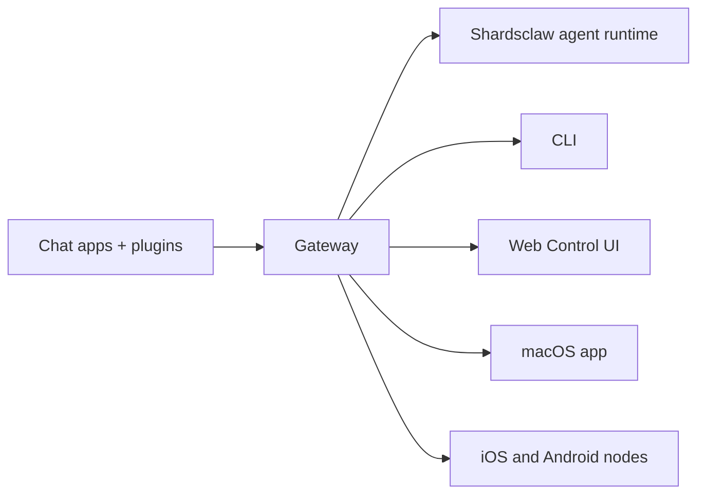

# Shardsclaw

<p align="center">
  <strong>Your AI assistant, on your own hardware, in the chat apps you choose.</strong><br />
  One Gateway. Any model. Any device. No hosted service in the middle.<br />
  An independently maintained fork of <a href="https://github.com/openclaw/openclaw">OpenClaw</a>; upstream history and attribution are preserved.
</p>

<Columns>
  <Card title="Get Started" href="/start/getting-started" icon="rocket">
    Build and run Shardsclaw from this source repository.
  </Card>
  <Card title="Run Onboarding" href="/start/wizard" icon="list-checks">
    Guided setup with `shardsclaw onboard`; the legacy `openclaw` command remains available for compatibility.
  </Card>
  <Card title="Connect a Channel" href="/channels" icon="message-circle">
    Link Discord, Signal, Telegram, WhatsApp, and more to chat from anywhere.
  </Card>
  <Card title="Open the Control UI" href="/web/control-ui" icon="layout-dashboard">
    Launch the browser dashboard for chat, config, and sessions.
  </Card>
</Columns>

## Browse docs

Mobile browsers may show the section menu without the full desktop tab bar. Use
these hub links to reach the same top-level docs areas from the page body.

<Columns>
  <Card title="Get started" href="/start/getting-started" icon="rocket">
    Overview, first steps, and setup guides.
  </Card>
  <Card title="Build from source" href="/install" icon="download">
    Shardsclaw source-build steps; inherited upstream install guides are clearly labeled and are not Shardsclaw downloads.
  </Card>
  <Card title="Channels" href="/channels" icon="messages-square">
    Messaging channels, pairing, routing, access groups, and channel QA.
  </Card>
  <Card title="Agents" href="/concepts/architecture" icon="bot">
    Architecture, sessions, context, memory, and multi-agent routing.
  </Card>
  <Card title="Capabilities" href="/tools" icon="wand-sparkles">
    Tools, skills, cron, webhooks, and automation capabilities.
  </Card>
  <Card title="ClawHub (external)" href="/clawhub" icon="store">
    Upstream ClawHub reference; the marketplace and its support channels are not operated by Shardsclaw.
  </Card>
  <Card title="Models" href="/providers" icon="brain">
    Providers, model configuration, failover, and local model services.
  </Card>
  <Card title="Platforms" href="/platforms" icon="monitor-smartphone">
    macOS, Windows, iOS, Android, nodes, and web surfaces.
  </Card>
  <Card title="Gateway & Ops" href="/gateway" icon="server">
    Gateway configuration, security, diagnostics, and operations.
  </Card>
  <Card title="Reference" href="/cli" icon="terminal">
    CLI reference, schemas, RPC, and templates.
  </Card>
  <Card title="Upstream releases (external)" href="/releases" icon="tag">
    Inherited OpenClaw release notes, not Shardsclaw releases.
  </Card>
  <Card title="Help" href="/help" icon="life-buoy">
    Troubleshooting, FAQs, testing, diagnostics, and environment checks.
  </Card>
</Columns>

## What is Shardsclaw?

Shardsclaw is an **independently maintained fork of OpenClaw**, a self-hosted gateway that connects chat apps — Discord, Google Chat, iMessage, Matrix, Microsoft Teams, Signal, Slack, Telegram, WhatsApp, Zalo, and more via channel plugins — to AI coding agents. You run a single Gateway process on your own machine (or a server), and it becomes the bridge between your messaging apps and an always-available AI assistant.

**Who is it for?** Developers and power users who want a self-hosted assistant they can message from anywhere, while retaining control of their data. See the [team deployment guide](/start/teams) for deployment trade-offs.

**What makes it different?**

- **Self-hosted**: runs on your hardware, your rules
- **Multi-channel**: one Gateway serves every configured channel plugin simultaneously
- **Agent-native**: built for coding agents with tool use, sessions, memory, and multi-agent routing
- **Open source**: MIT licensed

This repository's documentation includes upstream-authored OpenClaw reference material. It remains attributable to OpenClaw and is not evidence that Shardsclaw controls upstream services or plans.

**What do you need?** A Node.js version and pnpm release supported by the current source checkout, plus an API key from your chosen provider. See the `engines` and `packageManager` fields in the repository's `package.json` for exact requirements.

## How it works



The Gateway is the single source of truth for sessions, routing, and channel connections.

## Key capabilities

<Columns>
  <Card title="Multi-channel gateway" icon="network" href="/channels">
    Discord, iMessage, Signal, Slack, Telegram, WhatsApp, WebChat, and more with a single Gateway process.
  </Card>
  <Card title="Plugin channels" icon="plug" href="/tools/plugin">
    The source checkout includes channel plugins such as Matrix, Nostr, Twitch, and Zalo; separately published packages remain under their respective owners.
  </Card>
  <Card title="Multi-agent routing" icon="route" href="/concepts/multi-agent">
    Isolated sessions per agent, workspace, or sender.
  </Card>
  <Card title="Media support" icon="image" href="/nodes/images">
    Send and receive images, audio, and documents.
  </Card>
  <Card title="Web Control UI" icon="monitor" href="/web/control-ui">
    Browser dashboard for chat, config, sessions, and nodes.
  </Card>
  <Card title="Mobile nodes" icon="smartphone" href="/nodes">
    Pair iOS and Android nodes for camera, screen, and voice-enabled workflows.
  </Card>
  <Card title="Skills" icon="graduation-cap" href="/tools/skills">
    Teach the agent repeatable procedures it loads on demand.
  </Card>
  <Card title="Automation" icon="clock" href="/automation">
    Run work on a schedule with cron jobs, hooks, and webhooks.
  </Card>
  <Card title="Build plugins" icon="hammer" href="/plugins/building-plugins">
    Write your own channel, provider, and tool plugins against the plugin SDK.
  </Card>
</Columns>

## Build from source

This source checkout does not provide a Shardsclaw installer or published package.
Use the Node.js and pnpm versions declared by the repository:

```bash
git clone https://github.com/Shards-inc/shardsclaw.git
cd shardsclaw
pnpm install --frozen-lockfile
pnpm build
pnpm ui:build
pnpm dev
```

The `openclaw` CLI name and related configuration paths remain for compatibility.
See [Getting Started](/start/getting-started) for source development and
[OpenClaw upstream installation options](https://docs.openclaw.ai/install) only
when you specifically intend to install the upstream project.

## Dashboard

Open the browser Control UI after the Gateway starts.

- Local default: [http://127.0.0.1:18789/](http://127.0.0.1:18789/)
- Remote access: [Web surfaces](/web) and [Tailscale](/gateway/tailscale)

<p align="center">
  
</p>

## Configuration (optional)

Config lives at `~/.openclaw/openclaw.json`.

- If you **do nothing**, Shardsclaw uses the bundled agent runtime; DMs share the agent's main session, and each group chat gets its own session.
- If you want to lock it down, start with `channels.whatsapp.allowFrom` and (for groups) mention rules.

Example:

```json5
{
  channels: {
    whatsapp: {
      allowFrom: ["+15555550123"],
      groups: { "*": { requireMention: true } },
    },
  },
  messages: { groupChat: { mentionPatterns: ["@openclaw"] } },
}
```

## Start here

<Columns>
  <Card title="Docs hubs" href="/start/hubs" icon="book-open">
    All docs and guides, organized by use case.
  </Card>
  <Card title="Configuration" href="/gateway/configuration" icon="settings">
    Core Gateway settings, tokens, and provider config.
  </Card>
  <Card title="Remote access" href="/gateway/remote" icon="globe">
    SSH and tailnet access patterns.
  </Card>
  <Card title="Channels" href="/channels" icon="message-square">
    Channel-specific setup for Discord, Feishu, Microsoft Teams, Telegram, WhatsApp, and more.
  </Card>
  <Card title="Nodes" href="/nodes" icon="smartphone">
    iOS and Android nodes with pairing, camera, screen, and device actions.
  </Card>
  <Card title="Help" href="/help" icon="life-buoy">
    Common fixes and troubleshooting entry point.
  </Card>
</Columns>

## Learn more

<Columns>
  <Card title="Full feature list" href="/concepts/features" icon="list">
    Complete channel, routing, and media capabilities.
  </Card>
  <Card title="Multi-agent routing" href="/concepts/multi-agent" icon="route">
    Workspace isolation and per-agent sessions.
  </Card>
  <Card title="Security" href="/gateway/security" icon="shield">
    Tokens, allowlists, and safety controls.
  </Card>
  <Card title="Troubleshooting" href="/gateway/troubleshooting" icon="wrench">
    Gateway diagnostics and common errors.
  </Card>
  <Card title="About and credits" href="/reference/credits" icon="info">
    Project origins, contributors, and license.
  </Card>
</Columns>
